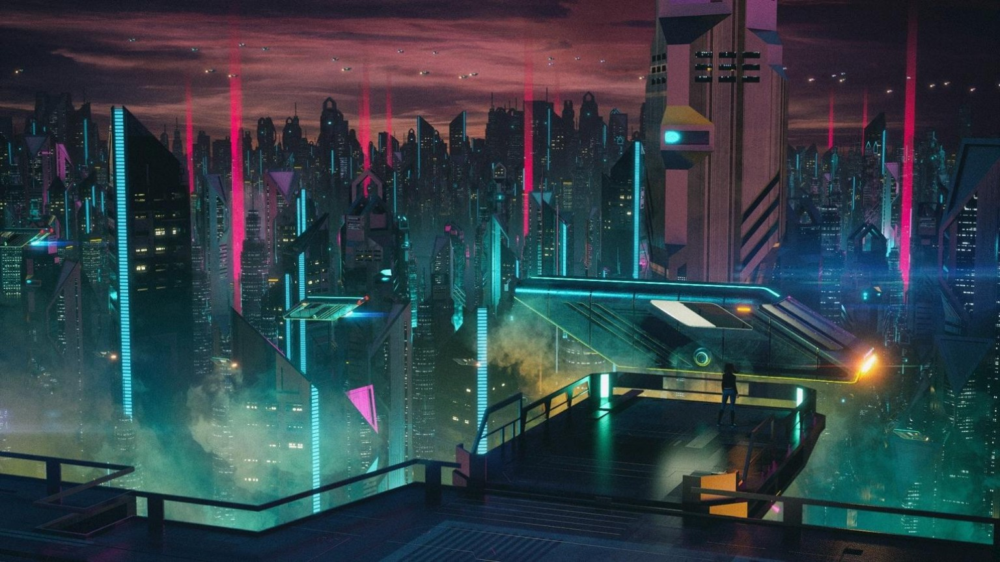

<div align="center">


<br/>


<br/>


<br/><br/>

# ABIR JICHKAR

### ENGINEERING THE FUTURE

`ECE STUDENT // TECHNOLOGY ENTHUSIAST`

<br/>


<br/>

`[ SYSTEM ONLINE ] — [ BUILD // LEARN // CREATE ]`

</div>

---

## `// 01 — ME`

> *"FACE THE MUSIC."*

Hey, I'm **Abir**, an ECE student and a vibe coder.

```text
+--------------------------------------+
|  USER      : ABIR JICHKAR            |
|  ROLE      : ECE STUDENT, EDITOR     |
|  STATUS    : LEARNING                |
|  INTERESTS : CODE / EDITING / TECH   |
+--------------------------------------+
```

- 🔹 Learning C programming
- 🔹 Interested in editing, gaming, and technology
- 🔹 Working towards building my own projects

---

## `// 02 — TECH STACK`

<p align="center">
  
</p>

<p align="center">
  
  
  
</p>

---

## `// 03 — INTERESTS`

<table align="center">
  <tr>
    <td align="center">⚡<br/><b>Electronics</b><br/>Circuits &amp; Components</td>
    <td align="center">💻<br/><b>PC Technology</b><br/>Hardware &amp; Systems</td>
    <td align="center">📼<br/><b>Editing</b><br/>Videography &amp; Editing</td>
  </tr>
</table>

---

## `// 04 — PROJECT DATABASE`

<p align="center">
  
</p>

<p align="center"><i>Currently experimenting and preparing to build.</i></p>

---

## `// 05 — ACHIEVEMENT VAULT`

<p align="center"><code>// MILESTONES UNLOCKED</code></p>

<p align="center">
  
  
  
</p>

<p align="center">
  
</p>

<p align="center"><code>BUILD // LEARN // CREATE // REPEAT</code></p>

---

## `// 06 — SOCIALS`

<p align="center">
  <a href="https://www.instagram.com/abir_jichkar/">
    
  </a>
  <a href="https://www.youtube.com/@Hellghost-5745">
    
  </a>
  <a href="https://www.reddit.com/user/1212stoner/">
    
  </a>
  <a href="https://www.pinterest.com/hellghost105/">
    
  </a>
  <a href="mailto:abirjichkar112@gmail.com">
    
  </a>
</p>

---

## `// 07 — STATS`

<p align="center"><i>Every expert was once a beginner.</i></p>

<p align="center">
  
  
</p>

---

<div align="center">


<sub>END OF TRANSMISSION · ABIR JICHKAR</sub>

</div>

